# Hopper for Android

**Nearby chat, nearby reels, and a wider social world.** Hopper pairs Bluetooth mesh conversations with phone-to-phone reel transfer over Wi-Fi Direct when supported. Nearby sharing can work without internet between compatible peers; places and the global feed still need internet-backed relays.

> **October 12 alpha prerelease available.** Download the signed universal APK and its checksum from the [official v0.3.5-alpha.1 release](https://github.com/hopper-social/hopper/releases/tag/v0.3.5-alpha.1-20261012). This is Hopper's download repository, not the Android source repository. The screens below are development captures and are not proof that they came from the signed public APK. Do not install APKs offered elsewhere.

## Why Hopper

- **Talk nearby:** Discover compatible phones and explore available groups. Supported Bluetooth mesh text can work without mobile data or Wi-Fi when peers are reachable; delivery depends on the connection.
- **Share reels phone to phone:** Between compatible connected peers, Hopper can offer a reel over the private session, transfer its bytes locally via Wi-Fi Direct, and verify the received file. Bluetooth pieces are a fallback when Wi-Fi Direct fails; neither path guarantees delivery. This is nearby media sharing, not an offline global feed.
- **Explore beyond range:** Spin the globe to choose an area and browse its conversations and notes, plus an online feed, profiles, photos, Reels, and music. These wider experiences depend on internet-backed relays; choosing an area does not claim you are there.

## How nearby sharing fits together

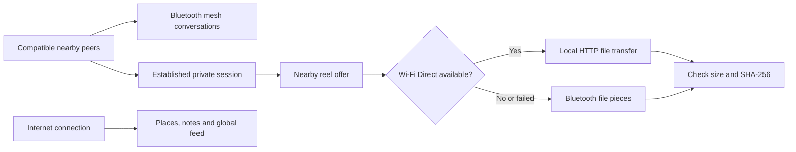

The reel offer uses a Noise-protected control message over an available peer transport; the Wi-Fi Direct file bytes use a separate local HTTP path, not a demonstrated Noise-encrypted payload channel. The receiver verifies file size and hash. An available transport is not a delivery guarantee.

## Hopper and Bitchat

| | Hopper for Android | [Bitchat](https://github.com/permissionlesstech/bitchat#features) |
| --- | --- | --- |
| Nearby | Bluetooth mesh conversations plus phone-to-phone reel bytes over Wi-Fi Direct when available, with Bluetooth fallback: nearby sharing beyond text | Bluetooth mesh messaging and multi-hop relay; its published feature list centers nearby messaging |
| Online | Place conversations and notes, profiles, photos, Reels and a feed | Nostr-backed global messaging and location channels |
| Focus | Nearby discovery alongside a broader social and media experience | Messaging across nearby mesh and internet relays |

These are different product emphases, **not** a speed, range, reliability or security ranking. Both support nearby communication and internet-backed experiences. Hopper is **not** the official Bitchat app; no general Bitchat interoperability is promised.

## A look inside

See all 14 development captures

All 14 supplied phone captures are shown below. These are **edited v0.3.5-alpha.1 development captures**, not verified screenshots of the signed public APK or proof of message delivery. System bars were cropped; private conversations, posts, build details, and third-party media previews were covered before publication. Blank labeled regions are redactions, not empty app states. Places and discovery counts reflect one session, not current network availability.

| Nearby home | Find a group |
| :---: | :---: |
|  |  |
| Groups, notes, and area conversations. | Search, scan a code, or refresh discovery. |

| Nearby communities | Choose an area |
| :---: | :---: |
| 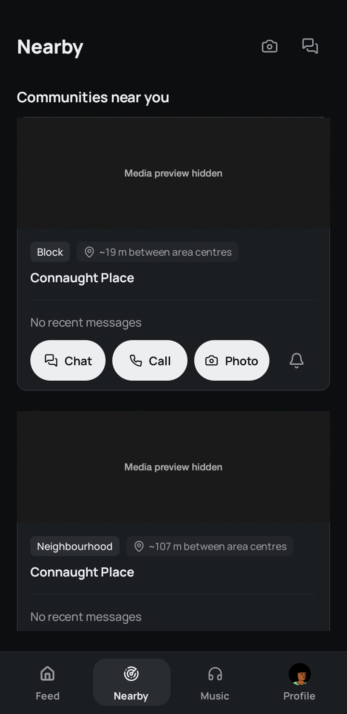 |  |
| Community cards and available actions. | Spin and zoom to choose a broad area. |

| Place conversation | Place notes |
| :---: | :---: |
| 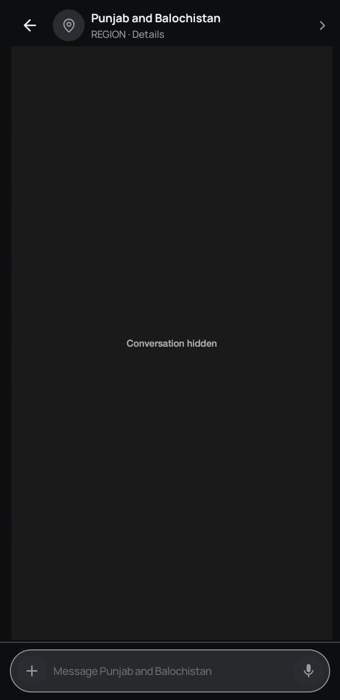 | 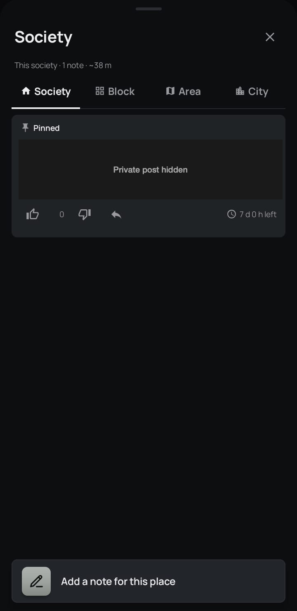 |
| Conversation view; participants and messages hidden. | Browse or add notes for a place. |

| For you, dark | For you, another moment |
| :---: | :---: |
| 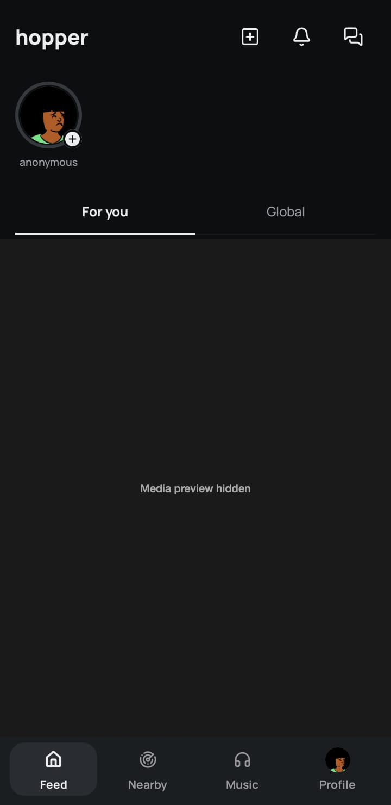 | 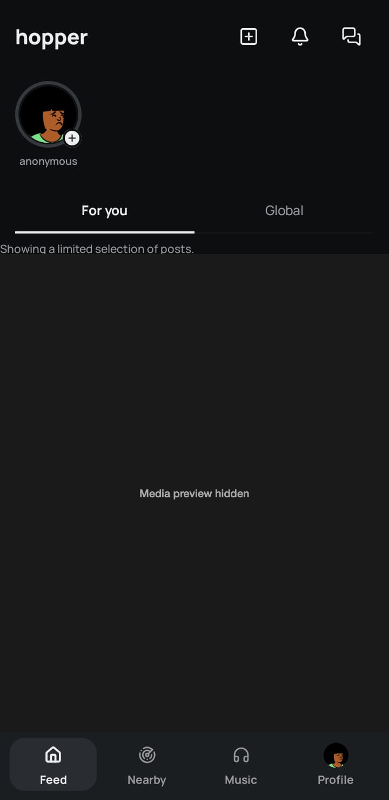 |
| The feed in dark appearance. | A second frame of the same feed view. |

| For you, light | Global feed |
| :---: | :---: |
| 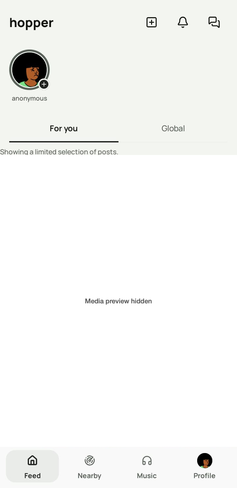 | 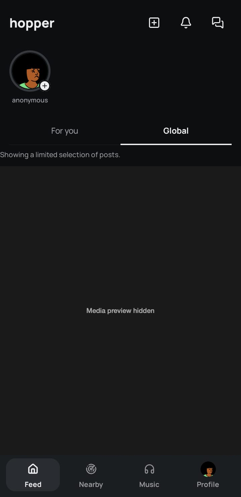 |
| The same tab in light appearance. | Switch to the wider Global feed. |

| Profile and Reels | Music library |
| :---: | :---: |
| 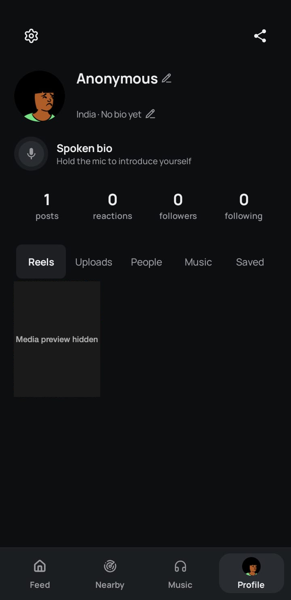 | 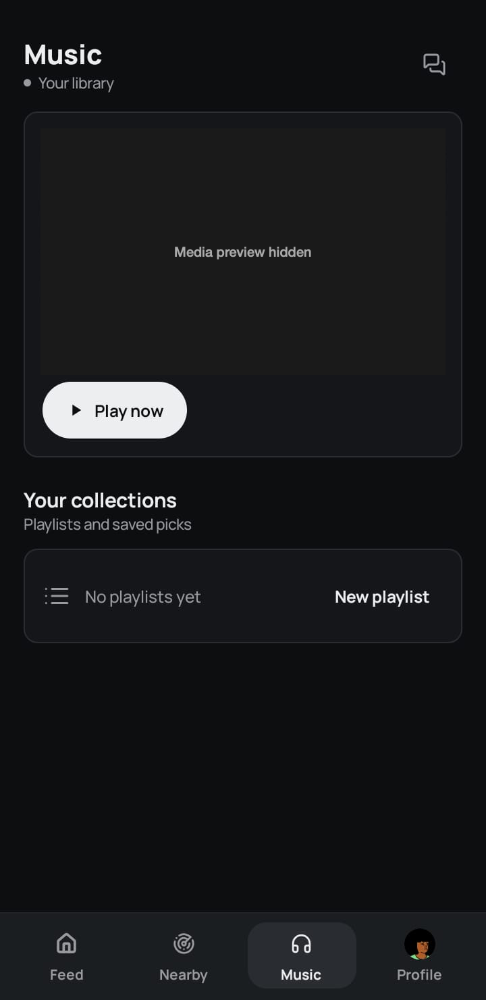 |
| Your profile and media tabs. | Library and playlist controls. |

| Appearance and safety | Reels and storage settings |
| :---: | :---: |
|  | 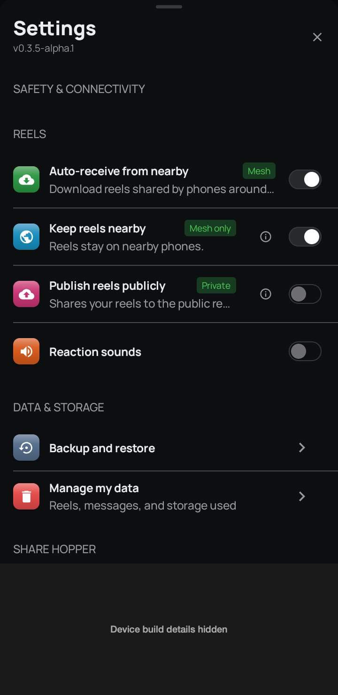 |
| Choose appearance and safety options. | Control media, storage, and sharing options. |

Hopper builds on the nearby-first approach of [Bitchat](https://github.com/permissionlesstech/bitchat) and uses the [Noise Protocol](https://noiseprotocol.org) for private mesh sessions. Thanks to the Bitchat and Noise communities. Bitchat releases are not Hopper downloads.

## Honest limits

- **Nearby messaging** needs compatible phones in range, Bluetooth, and the required permissions. Obstacles and available peers affect delivery; a "Sent" label does not confirm receipt. Hopper is an **alpha**, not an emergency service.
- **Places, notes, and the feed** need internet access and external relays. Choosing an area can reveal what places interest you, and optional location lookups may disclose more precise location data to external services. Public posts and media can be copied or retained elsewhere.
- **Nearby reels** need compatible, connected peers and supported devices. Wi-Fi Direct requires Android 10 or newer and the required permissions; the fallback can use Bluetooth but may fail. The protocol caps each reel at 256 MiB. The local Wi-Fi Direct HTTP payload is not established as end-to-end encrypted by Noise; a token limits access and a hash checks integrity. Do not assume nearby reel delivery or confidentiality in every environment.

Nearby access does not require a phone number. Read the [privacy information](https://hopper-social.github.io/hopper-legal-pages/privacy.html) and [account-data deletion limits](https://hopper-social.github.io/hopper-legal-pages/deletion.html) before sharing sensitive content.

## Get Hopper

1. Open the [October 12 alpha prerelease](https://github.com/hopper-social/hopper/releases/tag/v0.3.5-alpha.1-20261012). Under **Assets**, download the universal `.apk` and its matching `.sha256` file from that release. GitHub's automatic "Source code" archives here are neither the Android app source nor an installable APK.
2. Compare the APK's SHA-256 with the checksum file (`shasum -a 256 <file.apk>` on macOS or `sha256sum <file.apk>` on Linux). A match detects changed or incomplete downloads; it does **not** prove publisher identity. Check the repository address and release.
3. Open the APK on a compatible Android phone. Allow "Install unknown apps" for the browser or file manager only when prompted. To update later, install the new APK **over** the existing one. Android requires the same package and signing certificate to preserve app data; do not uninstall to bypass a mismatch. Back up anything important first.

Hopper is not currently on Google Play. Report problems through [Issues](https://github.com/hopper-social/hopper/issues) without posting private chats, device identifiers, or exact location history.
