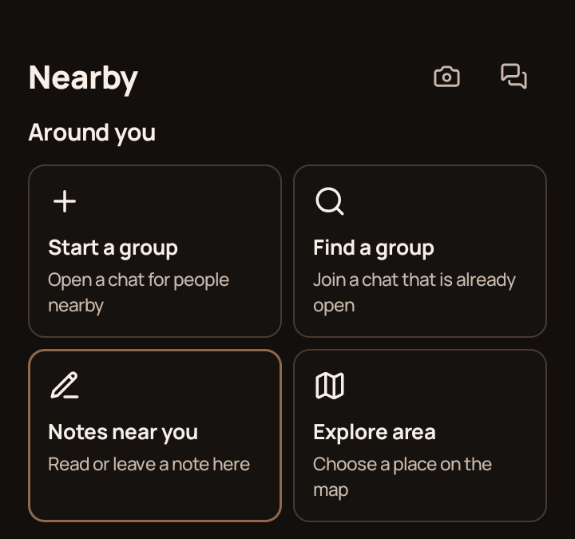
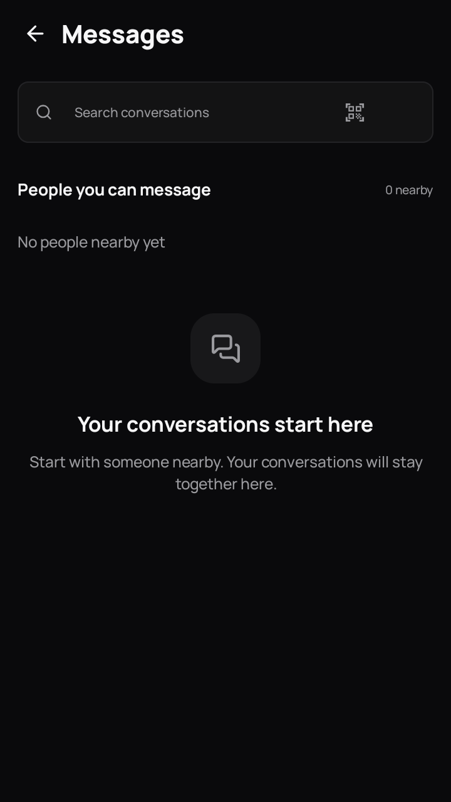

# Hopper for Android

Nearby conversations when the internet is out of reach; places and a social feed when you are connected. Hopper is an **alpha** Android app, not an emergency communication service.

> **No public APK is available yet.** This is Hopper's official download repository, not the Android source repository. The [Releases page](https://github.com/hopper-social/hopper/releases) is empty until a signed build passes release checks and is approved. Do not install APKs offered by other accounts or links.

## A look at the app

| Nearby | Messages |
| :---: | :---: |
|  |  |
| Cropped capture on a physical Android phone, **Hacker development build**. Location and chat content are excluded. | Capture from an installed Android build, showing **zero nearby peers**, not a completed conversation. |

These are real UI captures, not evidence of successful message delivery or the eventual signed public APK. Only these two screens have been vetted for public display; we will add other app screens after staging them with non-personal data and checking them on the release build.

## Picture a conversation

The following are **fictional examples, not screenshots or messages sent through Hopper**. Jantar Mantar is a mock setting, not a claim about anyone's current or past location.

**Nearby, with mobile data off:** Two people at a public meetup open Hopper and enable Bluetooth. One starts a group named "Jantar Mantar meetup"; the other searches for it. If their phones discover each other and the radios cooperate, their sample exchange might read:

> Participant A: "I'm by the entrance. Can you see the group?"  
> Participant B: "Found it. I'll meet you near the gate."

**Places, with internet:** Someone chooses the Jantar Mantar area on the map to see a place conversation. A possible sample post is "Anyone up for a photo walk this afternoon?" Place conversations use internet-backed relays; they do **not** work merely because two phones are nearby. A location-derived area or public post can reveal where you are interested in meeting. Choose what to share accordingly.

**Private conversation:** A direct message might say "Thanks for meeting up; I made it home." Delivery requires a reachable peer or an applicable online path. Do not rely on Hopper for urgent help or assume a message was received until the app confirms it.

## What to expect

- Nearby discovery and mesh messaging use Bluetooth and require another compatible Hopper phone, permissions, and enough radio reach. Obstacles, device support, and available peers affect delivery; offline does not mean unlimited range.
- Places, profiles, and the social feed use internet connectivity and external relays. Posts, recipients, relays, and media services can retain copies; local deletion cannot erase every independent copy.
- The app does not require a phone number to start the nearby experience. Check the [privacy information](https://hopper-social.github.io/hopper-legal-pages/privacy.html) and [account-data deletion limits](https://hopper-social.github.io/hopper-legal-pages/deletion.html) before sharing sensitive content.

## Download and update (once a release exists)

1. Open the [official Releases page](https://github.com/hopper-social/hopper/releases) and download the universal `.apk` and its matching `.sha256` file from the **same release**. GitHub's automatic "Source code" archives here are this download repository, not the app source or an installable APK.
2. Compare the APK's SHA-256 with the checksum file (`shasum -a 256 <file.apk>` on macOS or `sha256sum <file.apk>` on Linux). A matching checksum detects changed or incomplete downloads; it does **not** independently prove publisher identity. Verify the repository address and release before installation.
3. Install the APK on a compatible Android phone, allowing "Install unknown apps" for your browser or file manager only when prompted. For later updates, install the newer APK **over** the existing app. Do not uninstall to bypass an update error: Android requires a matching package and signing certificate to preserve app data. Back up anything important first.

Hopper is not currently distributed through Google Play. To report a problem after a release, use this repository's [Issues](https://github.com/hopper-social/hopper/issues) without posting private chats, phone identifiers, or exact location history.
