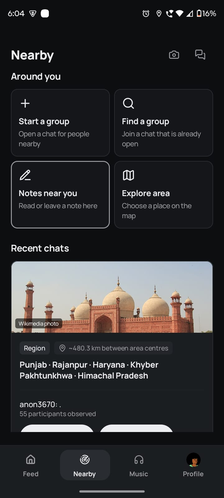
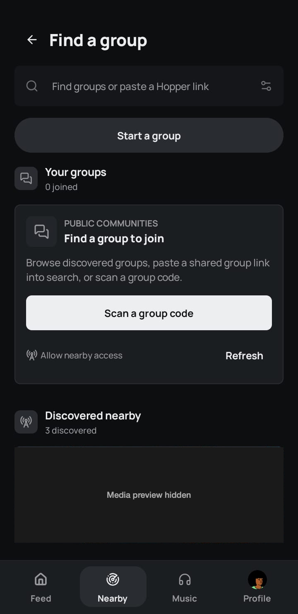
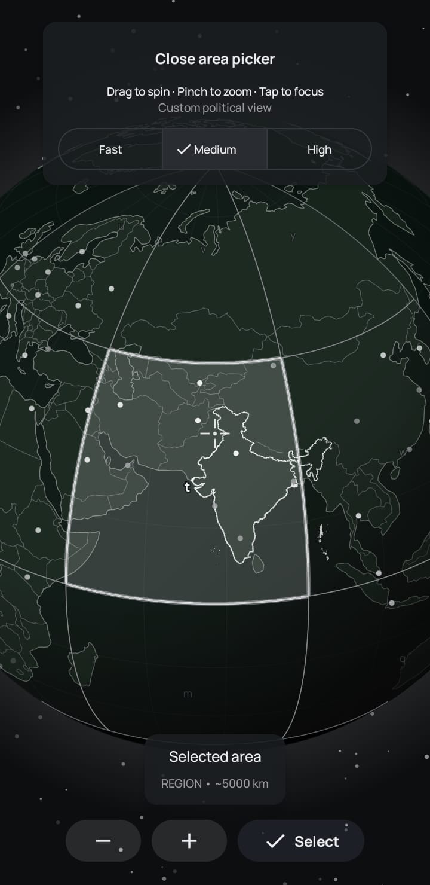
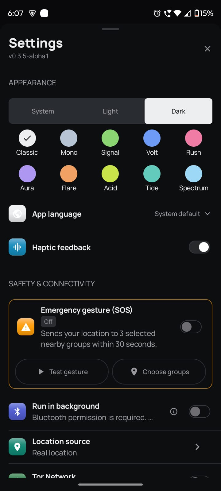

# Hopper for Android

**Talk nearby. Explore further.** Hopper brings Bluetooth mesh conversations together with place-based discovery, groups, and an online social feed. Nearby messages can work without internet when another compatible Hopper phone is reachable; places and live social content need a connection.

> **Release status: no public APK yet.** This is Hopper's official download repository, not the Android source repository. The [Releases page](https://github.com/hopper-social/hopper/releases) will list signed, approved builds when available. Until then, the screenshots below show an alpha development build, not a public release. Do not install APKs offered by other accounts or links.

## How Hopper connects

| Nearby, without internet | Places and social, with internet |
| --- | --- |
| Discover compatible Hopper phones, start or find groups, and exchange supported messages over Bluetooth mesh when peers are reachable. Range, permissions, and available relay peers affect delivery. | Explore area conversations and use the feed, profiles, and media features through internet-backed services and Nostr relays. Picking an area and sharing public content can reveal information beyond nearby peers. |

Wi-Fi Direct can carry nearby reel transfers on supported Android devices; it is not the Bluetooth mesh messaging transport. Hopper is an **alpha**, not an emergency communication service.

## See Hopper

These captures show the installed **v0.3.5-alpha.1 development build**. They document visible screens, not an approved APK or verified message delivery. Area names and discovery counts are examples from one session; results vary with device, location, permissions, and available peers.

| Nearby | Find a group |
| :---: | :---: |
|  |  |
| Start a group, find one nearby, read or leave notes, or explore an area. | Search by name or Hopper link, scan a group code, or refresh discovery. This capture shows three groups discovered, not joined. |

| Choose an area | Make it yours |
| :---: | :---: |
|  |  |
| Spin and zoom the globe to choose an area for place conversations. This example selects a broad region, not a precise position. | Set appearance, accent color, language, and haptics. Safety and connectivity options are also visible; the SOS gesture is switched off in this capture. |

The alpha also shows a **For you / Global** feed, profiles, Reels, photos, music, and a place-chat composer. Visible controls do not guarantee that content or sharing is available on every device or connection.

## About Hopper and Bitchat

Hopper extends the nearby-first approach of [Bitchat](https://github.com/permissionlesstech/bitchat) with an Android social experience built around places, a feed, media, and profiles. Private mesh sessions use the [Noise Protocol](https://noiseprotocol.org). The upstream [Bitchat Android app](https://github.com/permissionlesstech/bitchat-android) is a separate project: Hopper is **not** its official app, and its releases are not Hopper downloads.

## Know before using

- **Offline means nearby, not guaranteed.** Bluetooth must be available on compatible phones with the needed permissions and reachable peers. Obstacles and device support affect range; a "Sent" label alone does not confirm delivery.
- **Online activity has a wider audience.** New nearby notes, place conversations, profiles, and the feed depend on internet connectivity and external relays. Area selection may reveal location interests; public posts and media can be copied or retained elsewhere.
- **Start without a phone number.** Nearby access does not require one. Read the [privacy information](https://hopper-social.github.io/hopper-legal-pages/privacy.html) and [account-data deletion limits](https://hopper-social.github.io/hopper-legal-pages/deletion.html) before sharing sensitive content.

## Get Hopper when a release is available

1. Open the [official Releases page](https://github.com/hopper-social/hopper/releases). Under **Assets**, download the universal `.apk` and its matching `.sha256` file from the same release. GitHub's automatic "Source code" archives here are neither the Android app source nor an installable APK.
2. Compare the APK's SHA-256 with the checksum file (`shasum -a 256 <file.apk>` on macOS or `sha256sum <file.apk>` on Linux). A match detects changed or incomplete downloads; it does **not** prove publisher identity. Check the repository address and release.
3. Open the APK on a compatible Android phone. Allow "Install unknown apps" for the browser or file manager only when prompted. To update later, install the new APK **over** the existing one. Android requires the same package and signing certificate to preserve app data; do not uninstall to bypass a mismatch. Back up anything important first.

Hopper is not currently on Google Play. After a release, report problems through [Issues](https://github.com/hopper-social/hopper/issues) without posting private chats, device identifiers, or exact location history.
